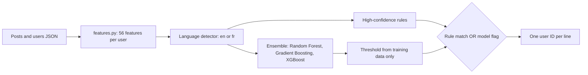

# Bot or Not: bot account detector


I built this detector alone for the McHacks "Bot or Not" challenge (February 2026), and it placed 7th overall.
The task is to find bot accounts in English and French X/Twitter data.
On the four labelled practice datasets, the detector scores 703 of 736 possible points (95.5% of the maximum challenge score).

## Results

The score is the challenge score divided by the maximum possible score.
It is not accuracy.
The maximum is 4 points times the number of bots in the dataset.
Each row comes from a model that never saw that dataset during training (see [Benchmark method](#benchmark-method)).

| Held-out dataset | Language | Score | Share of max |
| --- | --- | --- | --- |
| ds30 | English | 248/264 | 93.9% |
| ds32 | English | 240/252 | 95.2% |
| ds31 | French | 108/108 | 100.0% |
| ds33 | French | 107/112 | 95.5% |
| English total | English | 488/516 | 94.6% |
| French total | French | 215/220 | 97.7% |
| Overall | Both | 703/736 | 95.5% |

## The challenge

Influence bots are programs that pose as people on social media and push an agenda.
The organizers gave each team four labelled practice datasets, two English and two French.
Each dataset holds the tweets of several hundred accounts, and each user posted 10 to 100 tweets.
The labels list which accounts are bots.

The final evaluation used one unlabelled English dataset and one unlabelled French dataset.
The organizers released them on February 14, 2026 at 12:00 PM EST, and each team had one hour to submit.
The final data included a few bot types that the practice data did not contain.
The output is one file per language, named `[team].detections.[lang].txt`, with one user ID per line.

The scoring has three terms:

- +4 for each bot caught (a true positive)
- -1 for each bot missed (a false negative)
- -2 for each human flagged as a bot (a false positive)

A wrong flag costs more than a miss.
For this reason the detector is precision-first and flags an account only when the evidence is strong.

## How it works



`src/features.py` turns each user into 56 numbers.
They cover posting-time patterns, text repetition and compression, hashtag and punctuation use, and same-second posting collisions.
They also cover account metadata and each user compared against the topic and activity averages of the dataset.

Each language has its own detector, because the bot patterns differ between English and French.
Each detector combines two parts.
The first part is a small set of high-confidence rules, 4 for English and 6 for French.
The second part is an ensemble, which is a set of models whose scores are combined.
It uses a Random Forest (300 trees, averaged over several seeds), Gradient Boosting (150 trees), and XGBoost (150 trees).
A weighted average of the three scores gives one bot probability per user, and the weights differ by language.
An account is flagged if a rule matches or if the model flags it.

The decision threshold comes from the training data only.
The final pipeline tries each candidate threshold on held-out folds of the training data.
It also scores each candidate on 400 resampled scenarios that change the bot rate and the mix of hard-to-classify humans.
The pipeline then picks the threshold with the best mix of worst-case, median, and baseline score.
The threshold has a floor of 2/7.
The floor follows from the scoring costs.
A flag only pays off when the chance that the account is a bot is at least 2/7.
The models train on all four practice datasets, English and French together.

The French detector adds two controls:

- The rate clamp raises the model threshold when rule and model flags together go over a cap. The cap is the larger of 25% of users and the French practice bot rate plus 8 points.
- The human-likeness veto drops a model-only flag when the ensemble score is below 0.40 and a separate logistic regression rates the account as more human than 99% of training bots. Rule matches are never vetoed.

DBSCAN "digital DNA" clustering is an optional experiment in `src/dna_cluster.py`.
It groups users with similar behavior sequences, and both detectors can use it.
It is off by default.
Setting `BOTORN0T_USE_DNA_CLUSTER=1` turns it on.
I did not use it in the final run or in the benchmark, so it did not contribute to any score above.

## Benchmark method

The benchmark in `src/strict_eval.py` uses leave-one-dataset-out evaluation.
Each practice dataset is held out in turn, and the model trains on the other three.
The threshold comes from a plain sweep over folds of those three datasets only.
The held-out dataset is scored once, with no tuning on it.

## Final submission

I ran the final pipeline on ds34 (English) and ds35 (French).
The organizers gave no labels for these datasets, so I have no final score of my own.

| Output file | Users flagged | Total users | Share flagged |
| --- | --- | --- | --- |
| `localhost.detections.en.txt` | 74 | 438 | 16.9% |
| `localhost.detections.fr.txt` | 35 | 283 | 12.4% |

For context, the bot share in the practice data was about 23.6% for English and 16.0% for French.
The team name is `localhost`, and I was the only member.

## Run it

The pinned requirements install on Python 3.11 (tested).
On Python 3.13 and newer, the install fails because numpy 2.0.2 has no wheel for them.

From the repo root, run the final pipeline:

```bash
pip install -r requirements.txt
python3 src/run_final.py "data/dataset.posts&users.34.json" "data/dataset.posts&users.35.json" --team localhost
```

The quotes are required because the filenames contain `&`.
The command writes `localhost.detections.en.txt` and `localhost.detections.fr.txt` in the repo root.

To reproduce the benchmark, run:

```bash
python3 src/strict_eval.py
```

## Repo layout

| File | Purpose |
| --- | --- |
| `src/features.py` | Extracts the 56 per-user features |
| `src/en_detector.py` | English rules, ensemble, and threshold selection |
| `src/fr_detector.py` | French rules, ensemble, rate clamp, human-likeness veto, and threshold selection |
| `src/dna_cluster.py` | Optional DBSCAN clustering of behavior sequences, off by default |
| `src/run_final.py` | Runs both detectors and writes the submission files |
| `src/strict_eval.py` | Leave-one-dataset-out benchmark |
| `src/stress_eval_en.py` | Compares plain and stress-tested threshold selection for English |
| `src/stress_eval_fr.py` | Compares plain and stress-tested threshold selection for French |
| `src/scorer.py` | Computes the challenge score from a detections file and a bot list |
| `src/test_features.py` | Tests for feature extraction on the practice datasets |
| `src/analyze_errors.py`, `src/compute_auc.py`, `src/diagnose_rules.py`, `src/run_en.py`, `src/run_fr.py`, `src/tune_hyperparams.py` | One-off scripts that I wrote during the hackathon |

## Data

The `data/` folder holds the datasets that the McHacks Bot or Not organizers provided.
Practice sets 30 to 33 come with bot labels, and final sets 34 and 35 do not.
The organizers anonymized mentions and URLs.
